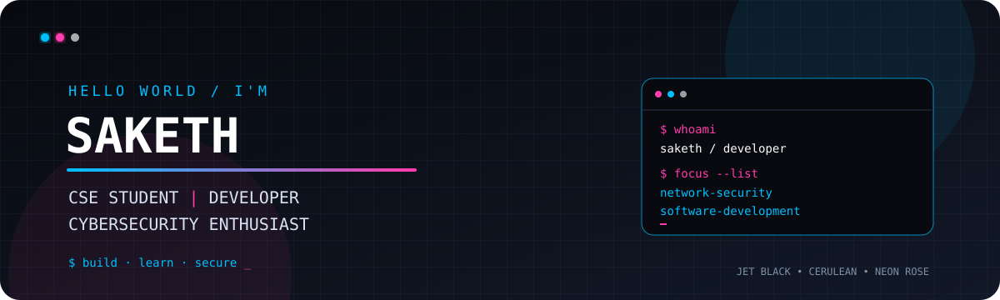

<!--
  SAKETH — GITHUB PROFILE README
  Theme: Jet Black + Cerulean Blue + Neon Rose
  Background: #080A0F
  Blue: #00BFFF
  Rose: #FF3CAC
-->

<!-- ==================== HERO BANNER ==================== -->

  

<h1 align="center">Hey, I'm Saketh! 👋</h1>

<h3 align="center">💻 CSE Student | Developer | Cybersecurity Enthusiast</h3>

  <b>Building projects. Exploring security. Learning continuously.</b>

  
  
  

---

<!-- ==================== ABOUT ME ==================== -->

## 🧑‍💻 About Me

I'm a Computer Science and Engineering student interested in software development, cybersecurity, and practical technology projects.

* 🎓 Pursuing B.Tech in Computer Science and Engineering at **KL University**
* 📊 Current CGPA: **7.78/10**
* 🔐 Exploring network security, penetration testing, and security monitoring
* 💻 Interested in programming, web development, and Linux
* 📈 Building practical projects to strengthen my technical skills
* 🎯 Goal: Grow as a developer and cybersecurity professional

---

<!-- ==================== EDUCATION ==================== -->

## 🎓 Education

<table>
  <tr>
    <th>Institution</th>
    <th>Qualification</th>
    <th>Duration</th>
    <th>Score</th>
  </tr>
  <tr>
    <td><b>KL University</b></td>
    <td>B.Tech — Computer Science and Engineering</td>
    <td>2023–2027</td>
    <td><b>CGPA: 7.78/10</b></td>
  </tr>
  <tr>
    <td><b>DePaul Junior College</b></td>
    <td>Intermediate — MPC</td>
    <td>2021–2023</td>
    <td><b>67%</b></td>
  </tr>
  <tr>
    <td><b>St. Vincent Convent School</b></td>
    <td>School Education</td>
    <td>Before 2021</td>
    <td><b>82%</b></td>
  </tr>
</table>

---

<!-- ==================== PROJECTS ==================== -->

## 🚀 Featured Projects

### 🥇 1. Network Penetration Testing Lab

A hands-on cybersecurity project focused on network reconnaissance, service identification, and security assessment within an isolated lab environment.

**Key Highlights**

* 🔎 Network reconnaissance using Nmap
* 🛡️ Service identification and security analysis
* 📡 FTP anonymous-access verification
* 🌐 HTTP and WebDAV security review
* 📋 Evidence collection and documentation
* 🐉 Kali Linux and Metasploitable2 lab environment

  

---

### 🥈 2. SecureCorp Security Assessment

A security assessment project documenting network reconnaissance, service discovery, web security observations, and findings from an authorized lab.

**Key Highlights**

* 🔍 Nmap reconnaissance and service mapping
* 📂 FTP anonymous-access verification
* 🌐 WebDAV configuration review
* 🔐 DVWA login-page security review
* 📝 Security evidence and assessment reporting
* 🧪 Controlled lab-based testing

  

---

### 🥉 3. SOC Log Analyzer

A security monitoring project focused on examining logs and understanding authentication events and potentially suspicious activity.

**Key Highlights**

* 📊 Security log analysis
* 🔎 Suspicious activity identification
* 🔐 Authentication-event monitoring
* 🛡️ Security monitoring fundamentals
* 📋 Log-based investigation and documentation

  

---

### 🎬 4. SAKETH — THE SERIES | Personal Portfolio

A cinematic, streaming-inspired portfolio where projects and personal information are presented in an episode-style experience.

**Key Highlights**

* 🎨 Cinematic interface and visual design
* 💻 Personal introduction and technical skills
* 🚀 Project showcase
* 📱 Responsive portfolio experience

  
  

---

<!-- ==================== TECHNICAL SKILLS ==================== -->

## 🛠️ Technical Skills

  

### Programming Languages

### Web Development

### Cybersecurity

### Tools and Platforms

---

<!-- ==================== CERTIFICATIONS ==================== -->

## 🏆 Certifications & Badges

  

  

  

  

  📜 Visit my <a href="https://saketh-portfolio-series.vercel.app/">portfolio</a> to explore my certificates and badges.

---

<!-- ==================== GITHUB STATS ==================== -->

## 📈 GitHub Statistics

  
  

---

## 📊 Contribution Activity

  

---

## 🐍 Contribution Snake

  

---

<!-- ==================== CONNECT ==================== -->

## 🤝 Let's Connect

  
  
  

  <i>“Learn continuously. Build practically. Secure responsibly.”</i>

  Designed with Jet Black <b>#080A0F</b>, Cerulean Blue <b>#00BFFF</b>, and Neon Rose <b>#FF3CAC</b>.

