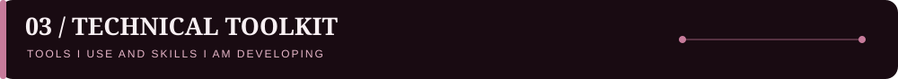

# SAKETH PULUGUTHA

### `COMPUTER SCIENCE` · `CYBERSECURITY` · `SOFTWARE DEVELOPMENT`

**Building skills. Breaking limits. Securing tomorrow.**

---

## 👨‍💻 About Me

* 🎓 **B.Tech Computer Science Engineering student at KL University**
* 🛡️ Interested in cybersecurity, SOC analysis, network security and defensive security.
* 🐍 Building practical projects with Python and security tools.
* 💻 Exploring software development, Linux, networking and log analysis.
* 🚀 Learning by building projects and documenting hands-on practice.

> *Stay curious. Build consistently. Keep learning.*

---

## 🚀 Featured Projects

### 🔐 01. Network Penetration Testing Lab

A hands-on, isolated cybersecurity lab focused on network reconnaissance, service identification and security observations.

**What I worked on**

* 🔎 Network reconnaissance using Nmap.
* 🗺️ Service identification and application mapping.
* 📡 FTP anonymous-access verification.
* 🌐 WebDAV and HTTP security observations.
* 🧪 DVWA login-page review.
* 📝 Evidence documentation and security assessment reporting.

**Technologies**

---

### 🐍 02. SOC Log Analyzer

A Python project that analyzes sample authentication logs and highlights suspicious login activity.

**Key features**

* Parses authentication log entries.
* Counts successful and failed login attempts.
* Flags repeated login failures as a potential brute-force pattern.
* Generates a readable security report.

**Technologies:** Python · Log Analysis · Basic Threat Detection

---

### 🎬 03. SAKETH — THE SERIES

A cinematic, streaming-inspired portfolio showcasing my projects, skills and development journey.

**Full-Stack Development · AI & ML · Cybersecurity · My Journey**

---

## 🏆 Certifications & Badges

My certificates and badges cover cybersecurity, cloud fundamentals, databases and automation.

### 📜 Certificates

| Certification                     | Issuer              | View                                                                      |
| --------------------------------- | ------------------- | ------------------------------------------------------------------------- |
| Introduction to Cybersecurity     | Cisco               | [View Certificate](https://github.com/2300030561/saketh-portfolio-series) |
| Microsoft Azure Fundamentals      | Microsoft           | [View Badge](https://github.com/2300030561/saketh-portfolio-series)       |
| Database Management System (DBMS) | NPTEL               | [View Certificate](https://github.com/2300030561/saketh-portfolio-series) |
| Certified RPA                     | Automation Anywhere | [View Certificate](https://github.com/2300030561/saketh-portfolio-series) |

### 🎖️ Digital Badges

> **Note:** The certificate buttons above currently point to the portfolio repository. Replace these links with the direct certificate or badge file URLs once the exact uploaded asset paths are confirmed.

---

## 🛠️ Technical Toolkit

### Programming & Development

### Database & Developer Tools

### Cybersecurity & Systems

---

## 📊 GitHub Activity

---

## 🐍 Contribution Snake

> If the snake image does not appear, the repository needs a GitHub Actions workflow to generate the `output` branch/file.

---

## 🤝 Connect With Me

### `LEARN CONTINUOUSLY.`

### `BUILD MEANINGFULLY.`

**Theme:** Jet Black · Cerulean Blue · Neon Rose

